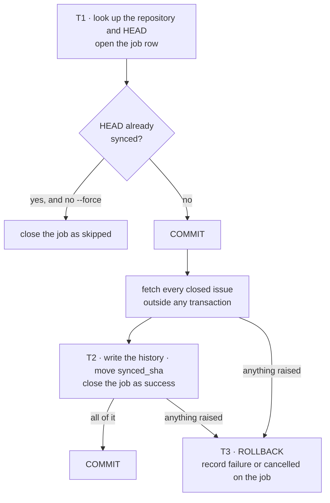
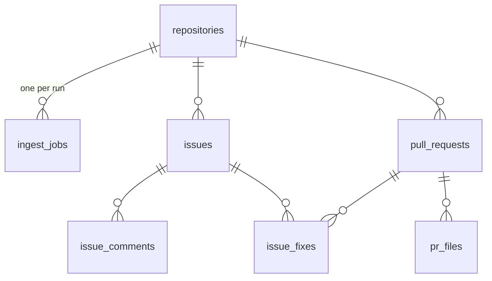

<div align="center">

# Issue Navigator

**Paste a GitHub issue. Get a briefing: the files to change, cited to exact lines, and how this kind
of bug was fixed before.**

[](https://www.python.org)
[](https://docs.langchain.com)
[](https://github.com/pgvector/pgvector)
[](https://ai.google.dev)
[](https://docs.github.com/en/graphql)
[](#roadmap)

</div>

---

> You've just been handed a ticket in a codebase you've never opened. The fix might be three lines.
> Finding *where* those three lines go takes the afternoon: a keyword search that returns forty
> matches, a dozen files opened in the wrong order, and no idea that the same bug was fixed a year
> ago, in a pull request nobody remembers.
>
> The answer is usually already in the repository, and not only in its code. On GitHub, a fixed
> issue is linked to the pull request that fixed it, and that pull request records exactly which
> files changed. That is years of *"this kind of bug lives in this file"*, written down by the
> maintainers themselves. Nobody has time to read eight hundred closed issues before starting work.
>
> **Issue Navigator reads them for you.** Give it an issue URL. An LLM reads the issue and its
> discussion and rewrites them as precise search queries, in the code's vocabulary rather than the
> reporter's. Navigator then searches three ways at once: the code by meaning, the code by exact
> identifiers and error messages, and the repository's past fixed issues, for the files their fixes
> changed. It fuses the three rankings into one, has an LLM read the top candidates and pick the
> files that matter, and hands back a briefing: the files to change, ranked and cited to exact
> lines, the similar issues fixed before, a plan, the tests to add and the risks to watch. Every
> file path is read from the index, never written by the model, so the briefing can be checked
> rather than trusted.
>
> The first hour of every ticket becomes the first minute.

And it is **scored, not demoed.** Navigator replays the repository's solved issues with the real fix
hidden, and checks whether it pointed at the files the maintainers actually changed. Every stage of
the pipeline has to raise that score to stay.

**Where it stands:** the code index and the fixed-issue history are built and running on
[`encode/httpx`](https://github.com/encode/httpx). The first ranked-files answer is being built
now. [Roadmap ↓](#roadmap)

---

## How it works

**Prepare a repository, once.** Two jobs, run side by side, each skipped when the repository's
HEAD hasn't moved since its last run:

```
                               GitHub repository
                                      │
                 ┌────────────────────┴────────────────────┐
                 ▼                                         ▼
   ┌───────────────────────────┐             ┌───────────────────────────┐
   │ RepoLens: index the code  │             │ Navigator: ingest history │
   │ clone · chunk · embed     │             │ issues · fix PRs · files  │
   └─────────────┬─────────────┘             └─────────────┬─────────────┘
                 ▼                                         ▼
             code index                               fix history
        every chunk, embedded                     issue → PR → files
```

**Brief an issue, in about a minute:**

```
                                    issue URL
                                       │
                                       ▼
                     ┌───────────────────────────────────┐
                     │ FETCH                             │
                     │ title · body · comments · labels  │
                     └─────────────────┬─────────────────┘
                                       ▼
                     ┌───────────────────────────────────┐
                     │ UNDERSTAND                        │
                     │ regex: identifiers, error strings │
                     │ LLM: 3–5 search queries, and a    │
                     │ HyDE guess at the fixing code     │
                     └─────────────────┬─────────────────┘
               ┌───────────────────────┼───────────────────────┐
               ▼                       ▼                       ▼
     ┌───────────────────┐   ┌───────────────────┐   ┌───────────────────┐
     │ BY MEANING        │   │ BY EXACT WORDS    │   │ BY HISTORY        │
     │                   │   │                   │   │                   │
     │ queries + HyDE    │   │ identifiers and   │   │ the issue → past  │
     │ guess, embedded   │   │ error strings     │   │ issues like it →  │
     │ → nearest chunks  │   │ → BM25 on chunks  │   │ files their fixes │
     │                   │   │                   │   │ changed           │
     │ from: code index  │   │ from: code index  │   │ from: fix history │
     └─────────┬─────────┘   └─────────┬─────────┘   └─────────┬─────────┘
               └───────────────────────┼───────────────────────┘
                                       ▼
                     ┌───────────────────────────────────┐
                     │ FUSE                              │
                     │ chunks rolled up to files,        │
                     │ then RRF → the top 15 files       │
                     └─────────────────┬─────────────────┘
                                       ▼
                     ┌───────────────────────────────────┐
                     │ RERANK                            │
                     │ the LLM reads the 15 candidates   │
                     │ and picks the files that matter,  │
                     │ as numbers, with a reason each    │
                     └─────────────────┬─────────────────┘
                                       ▼
                     ┌───────────────────────────────────┐
                     │ BRIEF                             │
                     │ plan · tests · risks, from that   │
                     │ evidence only. Each claim cites   │
                     │ its source by number: [1], [2]    │
                     └─────────────────┬─────────────────┘
                                       ▼
                     ┌───────────────────────────────────┐
                     │ VERIFY                            │
                     │ code turns each source number     │
                     │ into the file's path, its lines   │
                     │ and a GitHub link at that commit; │
                     │ a number with no source: dropped  │
                     └─────────────────┬─────────────────┘
                                       ▼
                                 cited briefing
```

| Component | In | Out | How |
|---|---|---|---|
| **Fetch** | an issue URL | title, body, comments, labels | GitHub's GraphQL API |
| **Understand** | the issue | its identifiers and error strings, 3–5 search queries (one per part of the problem), a HyDE guess at the fixing code, the issue's type and summary | regex first, then an LLM with structured output |
| **By meaning** | each query, and the HyDE guess | the nearest code chunks: one ranked list each | embedded exactly the way RepoLens embedded the code, then cosine search in pgvector |
| **By exact words** | the identifiers and error strings | the chunks that contain them | BM25 over RepoLens's chunks |
| **By history** | the issue | similar issues fixed before this one was opened, and the files their fixes changed | PGVector over Navigator's history, filtered by date |
| **Fuse** | every ranked list | the top 15 files | each list's chunks rolled up to files (a file scores its best chunk), then RRF |
| **Rerank** | 15 numbered candidates, with their code | the files that matter, with a reason each | an LLM with structured output: numbers, never paths |
| **Brief** | the chosen evidence | plan, tests to add, risks, open questions, citing `[n]` | RAG over that evidence only |
| **Verify** | every `[n]` in the briefing | paths, line ranges, commit-pinned GitHub links | plain code: a citation that doesn't match is dropped |

In **agent mode**, an LLM with tools replaces the searches, fusion and rerank with a loop (search,
read a file, follow a call, search again) inside a step budget, and is scored against this pipeline.

**Three searches, one ranking.** Code that reads like the issue, code that contains its exact
identifiers and error strings, and the files that fixed similar issues before. Each search misses
things the others catch, so their results are fused into one list before the model sees any of it.

---

## What a briefing looks like

On an illustrative repository:

```
Issue #212 — Password reset link says "expired" immediately
acme/taskapi · evidence from commit 3f9a1c2 (index is up to date)

ANALYSIS
  type: bug · expected: link valid for 30 min · actual: expires immediately for UTC+ users
  clues: "reset", "expired", "30 minutes", timezone (India)

LIKELY FILES TO CHANGE
  1. app/auth/tokens.py:88-110   compares expiry with datetime.utcnow()           high   [2]
  2. app/auth/reset.py:40-72     sets expiry with datetime.now() + 30 min         high   [1]
  3. app/utils/time.py:1-35      the UTC helper introduced for #158               medium [3]

WHY
  The token's expiry is created in local time but checked in UTC. For UTC+5:30 the
  token already looks 5.5 hours old when it is created [1][2].

SIMILAR PAST ISSUES
  #158 "Sessions expire early for non-UTC users" — fixed in PR #160 by switching to
       utils/time.now_utc()  (touched: app/utils/time.py, app/auth/session.py)

PLAN
  1. Use now_utc() when creating the reset token expiry [1][3]
  2. Search app/auth/ for other datetime.now() calls

TESTS TO ADD
  tests/auth/test_reset.py — a token created at UTC+5:30 stays valid for 30 minutes

RISKS
  Tokens already stored with local-time expiry will expire early once after deploy

SOURCES
  [1] app/auth/reset.py:40-72     github.com/acme/taskapi/blob/3f9a1c2/app/auth/reset.py#L40-L72
  [2] app/auth/tokens.py:88-110   …
  [3] app/utils/time.py:1-35      …
```

The past issue is what no code search could have found: the bug was already solved once, in a
different file, and the briefing says so. When the evidence is weak, the briefing says that instead:
*"No confident match. The closest areas were …"*

---

## Two kinds of knowledge

```
 ┌─────────────────────────────┐        ┌──────────────────────────────────────┐
 │ RepoLens: WHAT THE CODE IS  │        │ Navigator: WHAT HAPPENED TO IT       │
 │ every file, cut into chunks │        │ past issues · the PRs that fixed them│
 │ each chunk embedded         │        │ the files each fix changed           │
 │ pinned to one commit        │        │ issue text embedded for similarity   │
 └─────────────────────────────┘        └──────────────────────────────────────┘
                 └──────────────────┬─────────────────────┘
                                    ▼
                         combined to brief one issue
```

Navigator is built on [RepoLens](https://github.com/amritrwt22/RepoLens), which indexes a
repository's code for cited semantic search. RepoLens answers the question *you* ask. Navigator
starts from a task *someone else* wrote, often vaguely, and works out the questions itself.

| | RepoLens: the Ask lens | Issue Navigator: the Issues lens |
|---|---|---|
| Starts from | a question you ask | an issue someone else wrote |
| Who writes the searches | you | Navigator, from the issue |
| Knows | the code | the code **and** its history |
| Returns | a cited answer | a cited briefing: files, reasons, plan, tests, risks |
| Scored by | did it retrieve the right file for a question | did it find the files the real fix changed |

The two are separate services on one index. RepoLens doesn't know Navigator exists: Navigator reads
its code index through a read-only database account, and Postgres itself refuses any write.

---

## Alongside Claude Code, Cursor and Codex

Coding agents are excellent at writing the fix once a developer is sitting in the repository.
Navigator works one step earlier, and it knows things they don't.

| | Coding agents (Claude Code, Cursor, Codex) | Issue Navigator |
|---|---|---|
| **Its job** | write and test the change | find where the change goes, before anyone starts |
| **What it knows** | the code, explored fresh in every session | the code **and** the repository's fix history, indexed ahead of time: which files fixed which kinds of bug |
| **How accurate it is on your repository** | measured on public benchmarks, not on your repository | measured on your repository's own solved issues: recall@k, hit@k and MRR |
| **What starts it** | a developer opening a session and driving it | an issue URL, with no clone; it can brief every new issue the moment it's opened |
| **Where the result lives** | one developer's session | a briefing on the issue, read by the whole team: the maintainer, the newcomer, the lead planning the sprint |
| **Cost per issue** | varies with how much the agent explores | a fixed pipeline with a known number of model calls; the agent mode is kept only if it earns its cost |

### Better together

```
issue opened ──► Navigator briefing ──► Claude Code · Cursor · Codex ──► PR
                 files · past fixes     starts at the right files,
                 plan · tests · risks   with a plan and a checklist
```

- **The briefing is the ideal starting context.** Hand it to a coding agent, and the agent starts at
  the right files with line ranges, instead of searching the repository from scratch.
- **History the agent can't see.** *"#158 was the same mistake, fixed in `utils/time.py`"* gives
  the agent the precedent, and the approach that worked last time.
- **A checklist for the fix.** The briefing's tests to add and risks to watch become what the agent
  has to cover before the PR is opened.
- **Any editor, one briefing.** The team keeps the tools it already uses; Navigator supplies the
  map.
- **Next: Navigator as a tool the agent calls itself.** As an MCP server, Navigator plugs into
  Claude Code, Cursor or Codex directly: *"before you start, ask Navigator where this issue lives
  and how it was fixed last time."*

---

## Finding the right files

Working out which files an issue is about is a known research problem: **issue localization**.
Research systems are tested on SWE-bench, a public dataset of real GitHub issues, each paired with
the pull request that fixed it: a system scores well when it finds the files that fix changed.
Navigator builds the same kind of test set from its target repository's own history
([below](#scored-not-demoed)). Embedding the raw issue and taking the nearest code is the baseline
every published method beats, and every method that beats it puts the LLM in the loop. Navigator
adds those ideas one stage at a time:

| Stage | Technique | What it fixes | Grounded in |
|---|---|---|---|
| **Baseline** | the raw issue → embedding → nearest chunks → files | nothing yet: it is the number to beat | every paper's baseline |
| **Query rewriting** | the LLM splits the issue into clean search queries, one per part of the problem, and writes a guess at the fixing code (**HyDE**) | noise in the issue text, and the gap between how users describe a bug and how the code names it | RAG-Fusion, HyDE, multi-query retrieval |
| **Fusion** | search by meaning, by exact words (BM25) and by history, merged with **RRF** | each search misses different things | Agentless, hybrid retrieval |
| **Reranking** | the LLM reads the top ~15 numbered candidates and picks the files that matter, with a reason each | the right file found, but ranked too low | SweRank, BLAgent |
| **Agent** | a tool-calling loop: search, read, follow the call graph, search again, within a step budget | multi-hop bugs: the issue describes a symptom, and the cause is two calls away | AutoCodeRover, SWE-agent, LocAgent |

The research agrees on two things that shape the order: rewriting and reranking give the biggest
gains, and an agent is not automatically better, because a retrieve-and-rerank pipeline often matches
it at a fraction of the cost. So the agent comes last, it is **scored against the pipeline** on
accuracy, tokens and time, and it ships only if it wins.

### RRF: how three rankings become one

Each search returns its own ranking. A file's fused score is the sum, over every list it appears in,
of `1 / (60 + its rank)`:

```
                       by meaning   exact words   history     fused score
httpx/_urlparse.py         3             1            1        1/63 + 1/61 + 1/61 = 0.0487
httpx/_urls.py             1             4            -        1/61 + 1/64        = 0.0320
tests/test_url.py          2             -            -        1/62               = 0.0161
```

Only ranks are used, never raw scores, so lists whose numbers mean different things (cosine distance,
BM25 points, issue similarity) merge safely. A file that several independent searches rank well rises
to the top, even if no single search put it first.

Before fusing, each code search's chunks are rolled up to files (a file scores its best chunk),
since history search returns files already. Every rewritten query and the HyDE guess contribute a
ranked list of their own, so the issue is searched from several angles at once.

### Design principles

1. **Deterministic before generative.** Anything that can be computed exactly (identifiers and stack
   traces pulled out by regex, which PR fixed which issue, which files it changed) is computed, not
   asked of a model.
2. **The model writes a number; code writes the path.** See [below](#the-model-writes-a-number-code-writes-the-path).
3. **Baseline first.** The simplest version is measured before anything cleverer is added, and every
   addition has to beat it.
4. **Evidence or silence.** The briefing contains only what the retrieved evidence supports.
5. **A pipeline before an agent.** The agent is built only once the pipeline has a score to beat.

---

## Scored, not demoed

GitHub history provides an answer key for free. For a solved issue, the files its fix PR changed are
the right answer.

```
solved issue #340 ──► hide the fix ──► run Navigator ──► suggests: a.py, b.py, c.py
                                                                 │ compare
the real fix PR #345 changed:          b.py, d.py ◄──────────────┘
                                                                 ▼
                                         1 of 2 found in the top 3
```

| Metric | Question it answers |
|---|---|
| **Recall@k** (k = 1, 3, 5) | Of the files the real fix changed, how many are in the top *k*? |
| **Hit@k** | Is at least one correct file in the top *k*? |
| **MRR** | How high does the first correct file appear, on average? |
| **Citation validity** | What fraction of citations resolve to real evidence? Target: 100% |
| **Cost and latency** | Tokens, model calls, seconds and agent steps per briefing |

### No time travel

A replayed issue has to see the world as it was when the issue was opened, or the score means nothing:

- **Code from before the fix.** Evaluation runs on a snapshot of the repository at an older commit,
  indexed separately, so the fix isn't sitting in the index waiting to be found.
- **History from before the issue.** The past-issue search only sees issues created before the one
  being replayed, never the issue itself or its fix. A leakage test fails the build if it ever does.
- **The issue's own discussion, cut at the fix.** A replayed issue keeps only the comments written
  before its fix PR was opened, so a comment naming the file can't give the answer away.
- **A frozen test split.** The oldest ~70% of cases are for tuning; the newest ~30% are never tuned
  on, so a score can't be overfitted.
- **A coverage ceiling.** A fix that changed a file the index doesn't hold (a `.toml`, say) can never
  be found, so scores are reported against what was findable.

**Every stage is added one at a time and scored:** an ablation table of what each stage contributed
and what it cost. A stage that doesn't raise the score is removed.

---

## The model writes a number; code writes the path

This rule comes from RepoLens. The model never types a file path. It is shown numbered evidence and
cites `[1]`, `[2]`; code turns each number into a path, a line range and a GitHub link pinned to the
commit the evidence came from.

```
we send        →   15 candidates, numbered 1..15, and the shape the reply must match
model returns  →   { "files": [ { "candidate": 2, "reason": "..." }, ... ] }
we validate    →   drop any number outside 1..15
we look up     →   candidate 2 → app/auth/tokens.py:88-110 @ 3f9a1c2
```

| Failure | Caught by |
|---|---|
| A file path that does not exist | **impossible by construction**: paths come from the index, not the model |
| `[16]` cited when 15 candidates were sent | arithmetic, in code |
| A link whose lines shifted after someone edited the file | the commit sha in the URL |
| The model rewrites the briefing in prose and a parser misses a citation | **impossible**: structured output returns numbers in a typed field |

---

## Built: the history ingest

The part no other tool has is the history. Navigator turns a repository's GitHub history into an
answer key: for every issue that was really fixed, the PR that fixed it and the exact files it
changed.

```console
$ python -m navigator.services.ingest encode/httpx
encode/httpx: 279 issues kept, 583 dropped, synced at 7cff5f7

$ python -m navigator.services.ingest encode/httpx
encode/httpx: HEAD 7cff5f7 is already synced, skipped

$ python -m navigator.services.ingest encode/httpx --force
encode/httpx: 279 issues kept, 583 dropped, synced at 7cff5f7
```

The second run costs one API call. The forced run rewrites everything and changes no row count.

### One GraphQL request per page

Navigator uses GitHub's **GraphQL API**, not its REST API. One request returns a page of 25 closed
issues, each with its comments, the pull requests GitHub links as having closed it, and the files
each of those PRs changed. REST would need separate calls per issue for the comments, the closing
PR and its files.

httpx's 862 closed issues take **35 GraphQL requests**, and the whole ingest job (fetch, filter and
store) finishes in about **80 seconds**.

### Only issues whose fix can be proven

An issue is kept only when its answer key is certain:

- it was closed as **completed**, not as *not planned* or a duplicate
- it was closed by a **merged** pull request, using GitHub's own closing link rather than guessing
  from "fixes #N" text
- that PR merged into **this** repository, not a fork
- the PR's file list is **complete**: an issue whose list GitHub truncated is dropped, because a
  partial answer key would mark right answers as wrong
- **bot comments** are skipped; human comments are kept as context, since the discussion is often
  where the cause is found

Most closed issues on GitHub are questions, duplicates and won't-fixes closed by hand. They have no
fix to learn from, so 279 of httpx's 862 closed issues make the cut:

| encode/httpx · synced at `7cff5f7` | |
|---|---|
| closed issues scanned | 862 |
| issues with a proven fix | **279** |
| fix pull requests | 273 |
| issue → PR links | 286 |
| changed-file records (the answer key) | **1,069** |
| human comments | 1,254 |

### A job, not a script

Every run is a row in `ingest_jobs`, so an API client can start one and poll it. The work is split
into three transactions:



- **T1 commits alone**, so the job row survives whatever happens next.
- **The fetch holds no transaction.** Eighty seconds of network calls never keep the database
  waiting.
- **T2 is all or nothing.** A half-written history would look complete and quietly score wrong.
  `synced_sha` only moves when everything landed.
- **Skipping on HEAD is safe:** a newly fixed issue needs a merged PR, and a merge moves HEAD.
  `--force` covers what doesn't, such as new comments.
- **Every write is idempotent.** Each row is upserted on a natural key (an issue's number, a
  comment's GitHub id), so a forced re-run updates rows in place instead of duplicating them.

---

## Data model



| Table | Holds |
|---|---|
| `repositories` | owner and repo, matched case-insensitively · `synced_sha` and `synced_at`: the last commit fully ingested |
| `ingest_jobs` | one row per run: the commit, status, conclusion (`success` · `skipped` · `failure` · `cancelled`), kept and dropped counts, error, timing |
| `issues` | number, title, body, labels, created_at |
| `issue_comments` | the human comments on each issue, with GitHub's comment id and timestamp |
| `pull_requests` | number, title, body, merged_at, merge commit |
| `issue_fixes` | which PR fixed which issue (many to many: one issue can need two PRs) |
| `pr_files` | every file a fix changed, and how (added · modified · deleted · renamed) |

`created_at` on issues and comments is what keeps evaluation honest: history search filters on it,
so a replayed issue never sees anything from its own future.

---

## Built on LangChain

Each component has one concrete job in the pipeline:

| Component | Navigator's use | Phase |
|---|---|---|
| Custom `Embeddings` | `RepoLensEmbeddings`: embeds issue text exactly the way RepoLens embedded its code (same model, 768 dimensions, the code-retrieval query task type, normalised), checked by a parity test against RepoLens's stored vectors | 0 |
| `ChatGoogleGenerativeAI` | one configurable chat model behind every LLM step | 2 |
| `ChatPromptTemplate` | versioned prompt files, with few-shot examples drawn from the train split only | 2 |
| `with_structured_output` + Pydantic | `IssueAnalysis`, the ranked candidates and the `Briefing` come back as typed objects, never free text | 2 · 4 |
| Multi-query + HyDE chains | the issue becomes several targeted queries and a hypothetical fix, each searched | 2 |
| Custom `BaseRetriever` | semantic search over RepoLens's index, behind the evidence layer | 3 |
| `BM25Retriever` | exact identifiers and error strings | 3 |
| `PGVector` | past issues, embedded with their creation dates for time-filtered search | 3 |
| `EnsembleRetriever` | the three searches fused with RRF | 3 |
| `RunnableParallel` + LCEL | the searches run at once; the whole pipeline is one composed, traceable expression | 3 |
| `RunnableBranch` | different handling for bugs, features and questions | 4 |
| `@tool` + tool calling + agents | `search_code`, `keyword_code`, `read_file`, `list_files`, `search_past_issues`, `get_fix_files` and an `ast`-built code graph, in a loop with a step budget | 5 |
| Memory | follow-up questions on a briefing keep their context | 6 |
| Tracing (LangSmith or Langfuse) | every step of every run inspectable, so a bad briefing traces back to the stage that caused it | 2 |

---

## Architecture

```
                         GitHub API
                             │ issues · PRs · fix links · changed files
                             ▼
┌──────────────────────────── Issue Navigator ─────────────────────────────┐
│                                                                          │
│  Ingestion ───────► Navigator database                                   │
│                     issues · PRs · changed files · issue embeddings      │
│                     runs · traces · evaluation results                   │
│                                                                          │
│  Pipeline   understand ─► search ─► fuse ─► rerank ─► brief ─► verify    │
│                              │                  │                        │
│                              ▼                  ▼                        │
│  Evidence layer   (the only way into RepoLens)                           │
│                   search_code · keyword_code · read_file · list_files    │
│                                                                          │
│  Evaluation · Tracing · Model access (rate limits, caching)              │
│  API: briefings · follow-ups · history ingest · GitHub webhook           │
└────────────────────────────────────┬─────────────────────────────────────┘
                                     │ read-only
                                     ▼
                    RepoLens database (unchanged) ◄── RepoLens indexing
```

- **A separate database, on purpose.** Navigator can't join against RepoLens's tables, so the two
  can't quietly become coupled. The only path in is the evidence layer, which can later switch to
  RepoLens's HTTP API or an MCP server without touching the rest of Navigator.
- **Read-only, enforced by Postgres.** Navigator reaches RepoLens through an account with `SELECT`
  on three tables and nothing else.
- **API-first.** Every workflow is a function handed its connections. Long work runs as a job: the
  client gets an id at once and polls, and status, counts and failures live in database rows, never
  only in printed output. The commands in this README call the same functions an API worker will.
- **Deployed next to RepoLens**, as its own container sharing the Postgres server, so failures stay
  contained and releases stay independent.

---

## Quick start

**Requires** Python 3.11+, Docker, a running [RepoLens](https://github.com/amritrwt22/RepoLens)
(its Postgres container, `repolens-db`, on port 5433) with the target repository indexed, a
[fine-grained GitHub token](https://github.com/settings/personal-access-tokens) with read-only
access to public repositories, and a [Gemini API key](https://aistudio.google.com/apikey) (the free
tier is enough).

```bash
git clone https://github.com/amritrwt22/Issue-Navigator.git
cd Issue-Navigator

python3 -m venv .venv && source .venv/bin/activate
pip install -r requirements.txt

cp .env.example .env         # GITHUB_TOKEN, GOOGLE_API_KEY and the two database URLs
```

Create Navigator's database, its read-only account on RepoLens, and its tables. Each file is
idempotent:

```bash
docker exec -i repolens-db psql -U repolens  -d repolens  -v ON_ERROR_STOP=1 < sql/00_navigator_db.sql
docker exec -i repolens-db psql -U repolens  -d repolens  -v ON_ERROR_STOP=1 < sql/01_repolens_readonly.sql
docker exec -i repolens-db psql -U navigator -d navigator -v ON_ERROR_STOP=1 < sql/02_schema.sql
```

Ingest a repository's fixed-issue history:

```bash
python -m navigator.services.ingest encode/httpx            # skipped while HEAD hasn't moved
python -m navigator.services.ingest encode/httpx --force    # re-ingest anyway
```

Everything runs with `-m` from the repository root: imports are absolute.

---

## Layout

```
navigator/
  services/             complete workflows: what an API worker or a command calls
    ingest.py           one ingest job: fetch → filter → store, in three transactions

  pipeline/             one job per file, no database access
    github_client.py    the GitHub connection: the client, GraphQL calls, errors, limits
    fetch_history.py    FETCH:  the repository's HEAD, and every closed issue, unfiltered
    filter_history.py   FILTER: the ingest rules, as pure functions

  db/                   everything that writes to Postgres
    store_history.py    STORE:  idempotent upserts, and the job's records

sql/
  00_navigator_db.sql         Navigator's own database and account
  01_repolens_readonly.sql    the read-only account on RepoLens
  02_schema.sql               seven tables, with the reasoning in comments
```

Dependencies point one way: **services → pipeline, db**. A pipeline file never knows a workflow
exists, which is why `filter_history.py` can be tested with a dictionary and no network, database or
API key.

---

## Roadmap

| | Phase | What it adds |
|---|---|---|
| ✅ | **Prepare: code** | `encode/httpx` indexed by RepoLens at `7cff5f7`: 89 files, 491 chunks |
| ✅ | **Prepare: history** | 279 fixed issues with their fix PRs and changed files, as a recorded, skippable, idempotent job |
| 🚧 | **0 · Baseline** | issue → custom LangChain embeddings matching RepoLens → nearest chunks → ranked files with line ranges |
| ⬜ | **1 · Scorecard** | a snapshot from before the fixes, replayed issues, a frozen test split, recall@k and MRR |
| ⬜ | **2 · Query rewriting** | structured issue analysis, multi-query and HyDE, every step traced |
| ⬜ | **3 · Fusion** | meaning + exact words + history, fused with RRF; past issues in PGVector, filtered by time |
| ⬜ | **4 · Briefing** | LLM reranking, the cited briefing, and a refusal when the evidence is weak |
| ⬜ | **5 · Agent** | tool calling over the evidence layer and an `ast` code graph, scored against the pipeline |
| ⬜ | **6 · Product** | FastAPI service with job polling, follow-up questions with memory, Docker |
| ⬜ | **7 · Optimizer** | an agent that tunes the search settings overnight on the train split, never on the frozen test |
| ⬜ | **Later · MCP server** | Navigator as a tool for coding agents: Claude Code, Cursor or Codex asks it where an issue lives and how it was fixed last time, before writing a line |
| ⬜ | **Later** | a GitHub App that briefs new issues the moment they're opened, the Issues lens in RepoLens's frontend, reading RepoLens over MCP, LangGraph with human approval |

---

<div align="center">
<sub>Every stage has to beat the one before it on the scorecard, or it doesn't ship.</sub>
</div>
